# Juitar 产品视觉与功能验收手册

> 当前基线：`v0.1.0` · 原生 HTML + CSS + JavaScript + alphaTab

## 1. 产品设计美学

Juitar 的移动端主界面以纸面谱为中心：顶部只保留 40px 半透明导航，谱面占满剩余空间；暖琥珀色只用于导入、播放和 BPM 控件，笔记通过右下角按钮打开底部毛玻璃抽屉。

交互优先考虑移动看谱：一个曲目可以包含多张图片/PDF/GP/MusicXML 谱页，页面按顺序连续滚动；只有矢量谱显示右下角悬浮播放/BPM 药丸，笔记关闭后不占谱面空间。

## 2. 核心界面图鉴

### 桌面主工作台

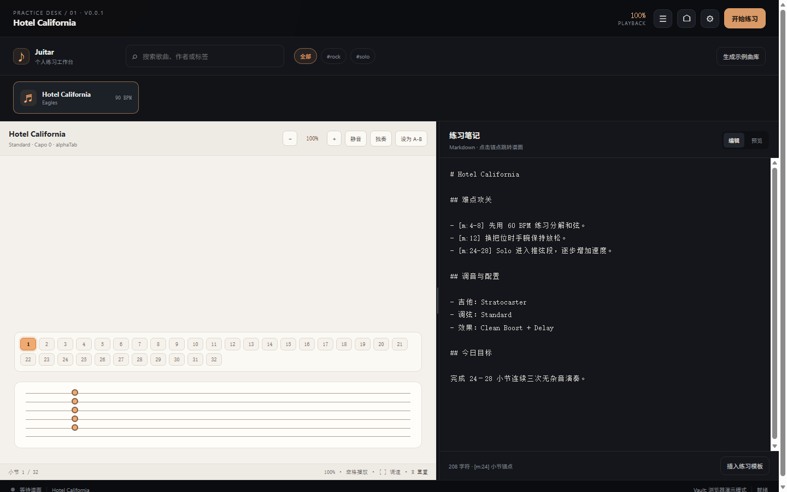

顶部是曲目上下文和播放入口；中段为曲库搜索与标签筛选；下方左侧是谱面视窗和小节导航，右侧是 Markdown 练习笔记。

### 手机竖屏看谱工作台

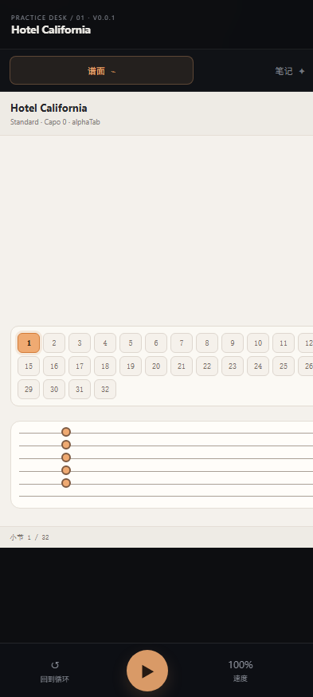

竖屏使用全宽谱面，顶部单行显示当前歌名与导入按钮；右下角便签按钮打开当前曲目笔记抽屉。

### 20:9 横屏

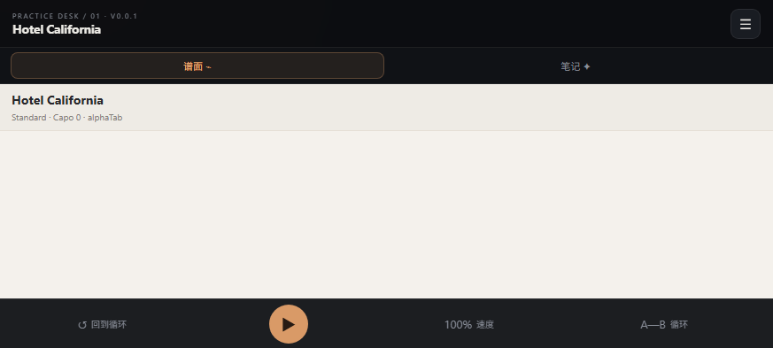

横屏通过短高度断点进入移动布局，避免 873×393 设备继续显示桌面分屏。

### 谱夹抽屉

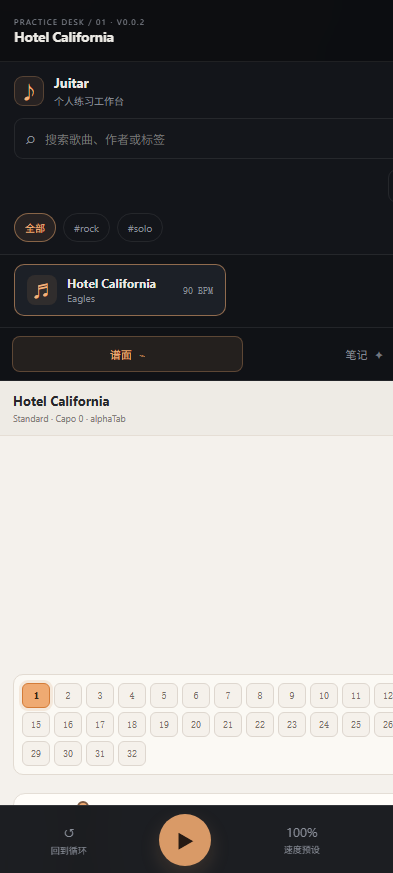

谱夹入口全屏显示曲目列表；进入曲目后可查看谱页数量、调整顺序并删除谱页，文件正文存入 IndexedDB。

### 笔记锚点与 A-B 循环

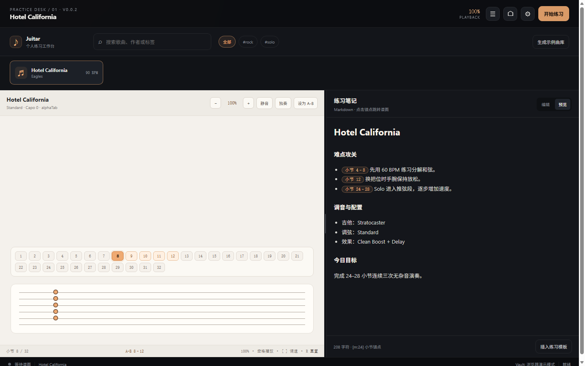

`[m:8-12]` 被解析为结构化小节锚点，点击后会将当前小节设为 8，并激活 8–12 小节循环。

### 移动笔记面板

移动端笔记单独占满工作区，仍保留自动保存和 Markdown 编辑 / 预览切换。

### Android 模拟器竖屏

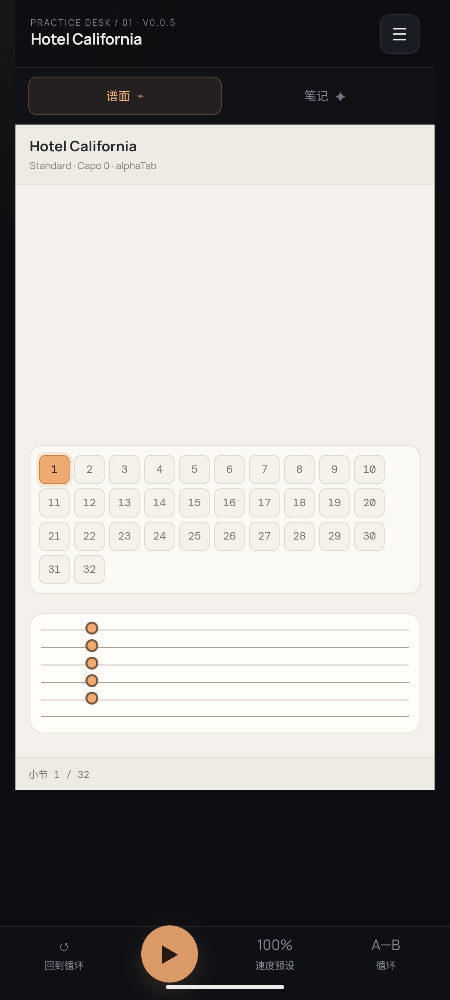

模拟器使用 `Medium_Phone_API_37.0`，通过 `adb install` 安装 APK 后启动 `com.juitar.app`，截图证明同一套 Touch Bar 和谱面工作区在 Android WebView 中可用。横屏布局使用前面的浏览器 873×393 截图验收。

## 3. 实战曲谱测试夹具

`sample-vault/Songs/` 中包含 4 首可直接扫描的 MusicXML 曲谱：

| 曲目 | 风格标签 | 复杂度测试点 |
|---|---|---|
| Hotel California | rock / solo | 基础小节定位、推弦练习笔记 |
| Midnight Drive | rock / alternate-picking | 多轨、交替拨弦、速度训练 |
| Maple Room Etude | fingerstyle / arpeggio | DADGAD、分解和弦、跨小节循环 |
| Neon Skyline Solo | solo / bending | 降半音、推弦、滑音和变速段落 |

每首曲目都包含 `song.json`、`score.musicxml`、`notes.md` 和 `practice-log.md`。笔记均包含 `[m:4]`、`[m:8-12]` 和设备 / 调弦记录。

## 4. 已执行验证

- `npm run test`：3 个测试文件、8 个测试通过。
- `npm run build`：Vue 类型检查与 Vite 生产构建通过。
- 本地浏览器真实渲染截图：桌面 1440×900、竖屏 393×873、横屏 873×393。
- 锚点状态截图：`?showcase=anchor` 进入 8–12 循环状态。
- 曲库状态截图：`?showcase=library` 展开移动曲库抽屉。
- 笔记状态截图：`?showcase=notes` 进入移动笔记面板。
- Android 模拟器：APK 安装成功，启动焦点为 `com.juitar.app/.MainActivity`，竖屏截图已保存。

### 浏览器端到端实战记录

在本地浏览器真实 DOM 上完成了以下操作：进入 Markdown 预览 → 编辑并保存包含 `[m:8-12]` 的练习记录 → 点击锚点胶囊 → 验证当前小节为 8、A-B 为 8–12 → 连续点击调速减号五次，将速度从 100% 调到 75% → 点击“开始练习”，按钮切换为“暂停”。该流程运行期间浏览器控制台错误日志为空；此前 `[m:24-28]` 也完成了同样的联动验证。

## 5. 版本演进

| 版本 | Commit | 摘要 |
|---|---|---|
| v0.0.1 | `d4aab2f` | 统一版本基线；建立深色设计系统；加入响应式工作台、移动 Touch Bar、曲库抽屉和截图验收资产。 |
| v0.0.2 | `933babc` | 增加 70% / 80% / 100% 练习速度预设；锚点验收进入真实 Markdown 预览；补齐多首 MusicXML 实战夹具。 |
| v0.0.3 | `68be082` | 补齐曲面屏安全边距、触控目标和移动端触摸行为。 |
| v0.0.4 | `37b9443` | 让谱面字体、音色和演示曲谱使用 Vite base URL，兼容 Android asset 离线加载。 |
| v0.0.5 | `0fbabfa` | 生成 Android WebView APK；在 `Medium_Phone_API_37.0` 模拟器安装并完成竖屏截图验收。 |
| v0.0.6 | `70426e9` | 固定 Vitest 单 worker 回归配置；完成最终 Android APK 与交付文档。 |
| v0.0.7 | `af8ec29` | 推倒旧分屏，改为原生单页全宽看谱 / 笔记；默认 AlphaTex 真六线谱和图片/PDF/GP/MusicXML 导入。 |
| v0.0.8 | `5f6b5d1` | 修复 Android WebView 文件选择器、手机缩放和直接打开 HTML 的空白问题。 |
| v0.1.0 | 当前工作树 | 重做为极简全屏手机谱夹：移除打卡统计和分屏，增加 IndexedDB 谱夹、底部笔记抽屉与矢量谱悬浮播放器。 |

## 6. 交付路径

- 截图：`docs/screenshots/`
- 示例曲库：`sample-vault/`
- 前端入口：[index.html](index.html) + [src/app.js](src/app.js)
- 视觉样式：[src/style.css](src/style.css)
- 构建记录：[BUILD_LOG.md](BUILD_LOG.md)

Android APK：`release-apk/Juitar-v0.1.0-arm64.apk`。该产物是无原生 ABI 的 Java/WebView 包装，兼容 ARM64 目标手机和 x86_64 Android 模拟器。

## 7. 极简全屏谱夹验收（v0.1.0）

本轮已移除运行时 Vue 分屏和数字矩阵，入口改为 `index.html + src/app.js + src/style.css`：

- 手机始终是单列全宽布局，顶部 40px 半透明导航，谱面占满剩余视口。
- 笔记默认隐藏，通过右下角便签按钮打开底部约 35% 的抽屉。
- 默认曲谱由 alphaTab 官方浏览器包 + AlphaTex 渲染，`renderFinished` 后显示 `真实六线谱已渲染`。
- 支持图片、PDF、GP3/GP4/GP5、GPX、MusicXML 文件导入；图片和 PDF 直接在全宽谱面视口中查看。
- 笔记支持 `[m:8]` 小节锚点跳转和本地自动保存；图片/PDF 不显示播放控件。

真实渲染截图：

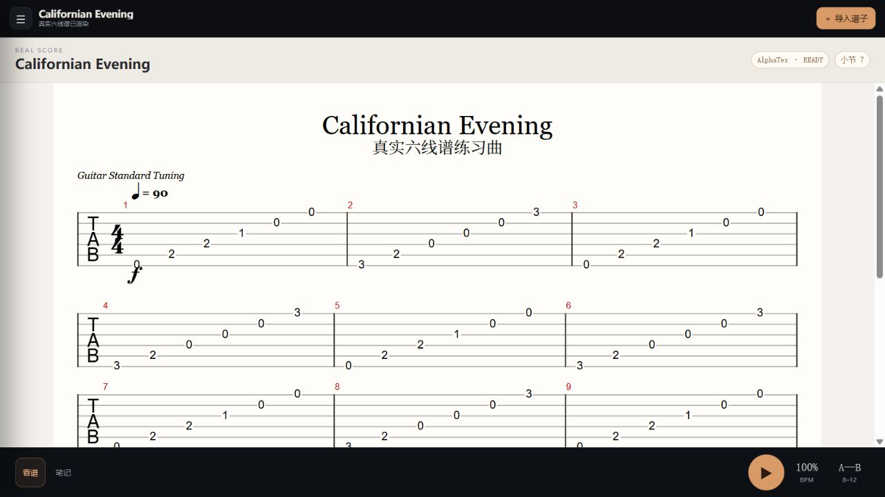

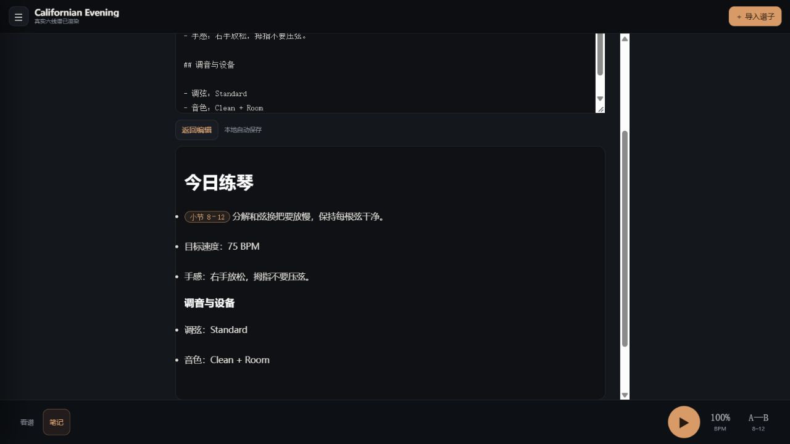

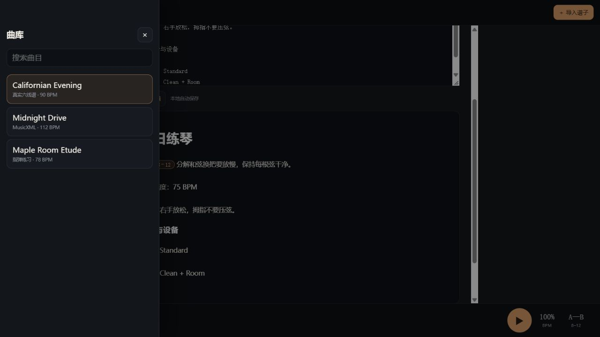

手机实机验收：

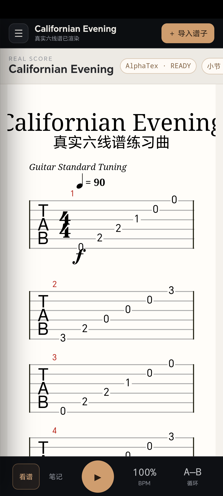

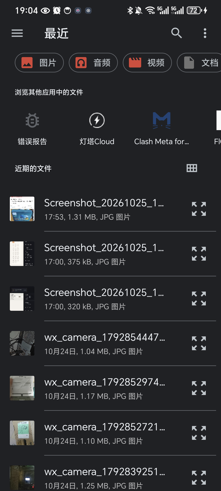

